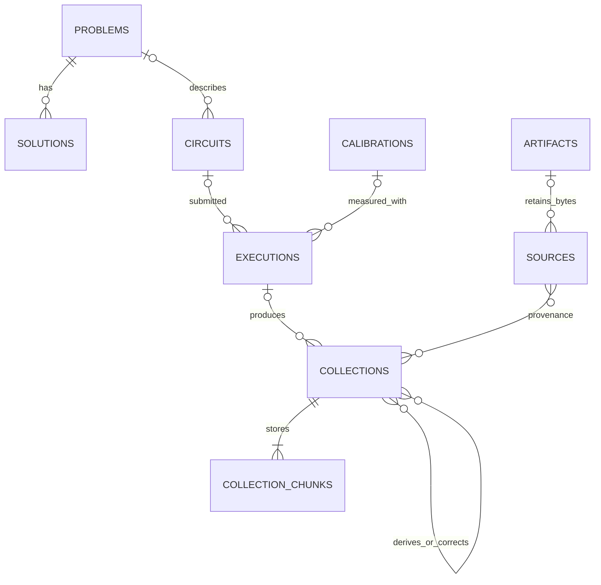

# OSR database and data model

## Decisions

OSR uses PostgreSQL (15 or newer) for the public multi-user service. Metadata and links are relational; sample payloads are immutable binary blocks. PostgreSQL supports concurrent transactions through MVCC and stores binary values as `bytea` ([concurrency](https://www.postgresql.org/docs/current/mvcc-intro.html), [binary data](https://www.postgresql.org/docs/current/datatype-binary.html)). SQLite is retained as a read-only legacy migration input, not the production storage engine.

Every resource ID is a server-generated UUIDv4. Content hashes identify bytes or exact circuit fingerprints; they are not resource IDs. No authentication, API keys or rate limiting is introduced. Upload sizes and numerical validation are resource/data-integrity bounds, documented in the deployment guide.

A collection describes one result distribution. It retains its own source and execution even when clients aggregate counts across runs. Published collections, their blocks, and their metadata cannot be edited or deleted through the API. Corrections create a new collection with `supersedes_id`; analysis products reference `parents`. Missing acquisition details stay null. Ingestion time is separate from execution time and source filename date labels.

## Entities

| Entity | Information |
| --- | --- |
| `artifacts` | Original bytes, SHA-256, format and MIME type: bound circuits, problem/solution definitions and partial calibration |
| `sources` | Source URI/path, SHA-256, format and optional original artifact; source metadata |
| `problems` | Problem kind, explicit variable count, ordered variable basis, weighted edges, objective direction and parameters |
| `solutions` | Packed state, objective value, feasibility, status (`candidate`, `feasible`, `optimal`, `target`, `forbidden`), provenance/evidence |
| `circuits` | Exact fingerprint/scheme, original artifact references and circuit index, quantum/classical widths, registers, measurement pairs, layouts, depth/gate statistics, problem and QAOA p |
| `calibrations` | Backend, snapshot/property times and units, source/date label, completeness, physical-qubit/gate properties, original artifact |
| `executions` | Backend, bound circuit, optional provider job ID, execution times/date label, options, calibration and physical/measurement mappings |
| `collections` | Result kind, measured width, indexed backend/circuit/problem/p/time/calibration, execution, tags, version/parent/source links and totals |
| `collection_chunks` | Sorted disjoint sample/value blocks with checksum, entry/shot totals for computing read positions |
| `uploads`, `upload_chunks` | Unpublished staging data; transactions publish a complete validated collection atomically |

Typed definition bodies are retained as JSONB alongside columns used for indexed search. This preserves problem-specific fields and property units without inventing a separate SQL table for every quantum algorithm. Relationships use foreign keys. Definitions and calibration are supplied explicitly; no fake-backend or later-calibration substitution fills missing execution metadata.

## Samples and values

In Rust, a bitstring is `[u64; 4]`: word 0 contains bits 0–63, word 3 bits 192–255. Bit 0 is the least significant integer/classical bit. Measured width is **1–256**; unused high bits must be zero. Display strings are exactly `width` characters, most significant first. Source conventions are recorded explicitly; CPLEX solution strings and array columns are converted using their declared source ordering. Physical wires, circuit width, measured bits and problem variables remain distinct.

Counts use `u32` occurrences, strictly positive. Source observations are aggregated before upload, with occurrence overflow rejected. Duplicate encoded keys are rejected. Collection/aggregate totals use `u64`, bounded by PostgreSQL's signed BIGINT range. Float distributions use finite `f64`; probabilities are nonnegative and sum to one within 1e-9, quasi-probabilities allow negatives and also sum to one. `weighted_samples` supports finite nonnegative unnormalized weights. Hardware, simulation, mitigated, generated and unknown-origin counts are separate kinds. Floating values never become integer counts implicitly.

### OSB1 binary block

The same documented encoding is used for bulk HTTP and stored blocks:

| Offset | Bytes | Meaning |
| --- | ---: | --- |
| 0 | 4 | ASCII `OSB1` |
| 4 | 2 | Measured width, little-endian u16 |
| 6 | 1 | Value encoding: 0 = u32 count, 1 = f64 weight |
| 7 | 1 | Reserved, must be zero |
| 8 | 8 | Entry count, little-endian u64 |
| 16 | repeated | `ceil(width/8)` little-endian state bytes, then 4 count or 8 weight bytes |

At most 65,536 entries per block. Width-aware disk/wire encoding retains the `[u64;4]` processing representation without padding every 24-bit sample to 32 bytes. States are strictly increasing by unsigned numeric value, both within and across blocks. This prevents duplicate keys across an upload and supports deterministic replay. Checksum, width, finite values, zero padding, count bounds, ordering and full byte length are verified before publication. Reads return whole bounded blocks; no endpoint silently truncates a distribution.

A pending upload is mutable staging, not a published collection. Chunks are numbered contiguously from zero. Replaying identical chunks is idempotent; conflicting bytes fail. Finalization locks the upload, verifies all chunks and totals, and publishes metadata/blocks in one transaction. Clients can resume interrupted imports using an explicit idempotency key. There is no public DELETE or UPDATE route for published resources.

## Query and compatibility API

Queries and cache reuse exclude superseded versions by default; include_superseded exposes the full history. `/collections` pages metadata using an immutable ingestion-time/UUID cursor; block reads fetch one chunk at a time. Filters include backend, exact circuit fingerprint, measured width, kind, problem, p, execution time and calibration. Client `results()`, `results_int()`, `.filter()`, `.concat()`, `OSRClient` and `SamplerCache` remain available. Small `/shots` JSON requests/responses remain a compatibility interface; large collections use bulk endpoints, with an explicit error instead of partial JSON results.

Circuit fingerprints use SHA-256 of QASM3 UTF-8 (`qasm3-sha256-v1`), preserving the existing client's quantum-circuit hash convention. The bound circuit retains numerical gate parameters; no mandatory duplicate gamma/beta parameter table is introduced. QAOA p is separate searchable metadata. Artifact-byte fingerprints remain usable when QASM3 export is unavailable, but are a different explicit scheme. Unsupported Python objects do not receive repr-based circuit identities.

Sampler cache requests match **raw hardware counts, exact bound circuit, requested backend and measured width**. Historical runs may be combined, with optional execution-date/calibration filters. Simulation/derived/probability results stay available via explicit typed queries. The server selects exactly the requested number of observations without replacement from histogram mass; returned probabilities use the actual returned total. Unknown backend, unsupported execution options or unsupported input forms delegate to the wrapped sampler. V2 results retain PUB shape and classical registers; reconstructed shot order is labeled as such. Cache misses preserve the wrapped sampler result and auto-store completed results once, retaining job/execution metadata when available. [Qiskit documents the V2 PUB/register result format](https://quantum.cloud.ibm.com/docs/en/api/qiskit/primitives).

## Import and migration

The retained source scope is `store/` except `hex_swaps_mis_shots_bad`, `data/cplex/`, layouts/notebooks and relevant definitions. `figures/`, its calibration/analysis outputs, `backups/`, and other `data/` content are excluded. Raw source files remain unchanged. Import records path, file SHA, array key/index/noise factor, source ordering and association evidence. Separate runs are not merged on ingestion. Artifact copies are linked through identical hashes; equal counts alone do not deduplicate executions.

A source importer streams sorted binary count blocks and registers related graphs/solutions/circuits/partial calibration. Inferred or missing submitted-circuit links remain labeled; exact-fingerprint automatic cache reuse requires a confirmed association. Full execution calibration and precise times are not fabricated from filenames. Legacy SQLite records keep their original ID in provenance and receive UUIDv4 IDs; the old timestamp becomes ingestion provenance, not inferred execution time. Rerunning an import is idempotent, including recovery after a partial upload.

## Operations and verification

Debian deployment files supply PostgreSQL and a systemd service, with explicit environment configuration and graceful shutdown. The service binds only as configured; deployment itself is outside this local makeover. Database migrations are forward-only and never run against the old SQLite file. Integration tests run against real PostgreSQL and cover atomic publication, concurrent replay, immutable resources, pagination, binary extremes, type separation, provenance/solutions and cache sampling. Cross-repository tests exercise the real client against the server, including modern Qiskit sampler results and a source-data import.
